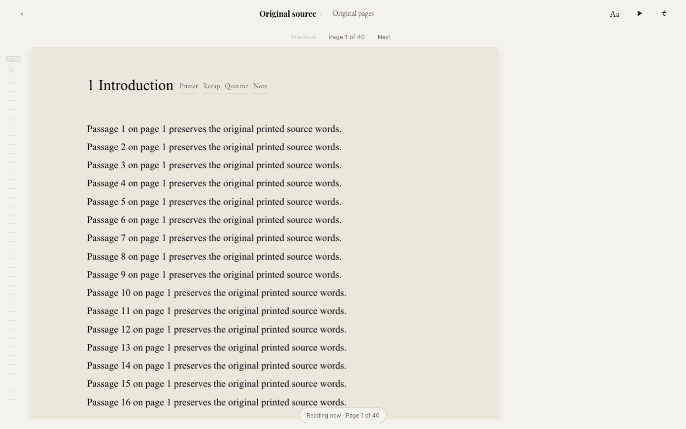
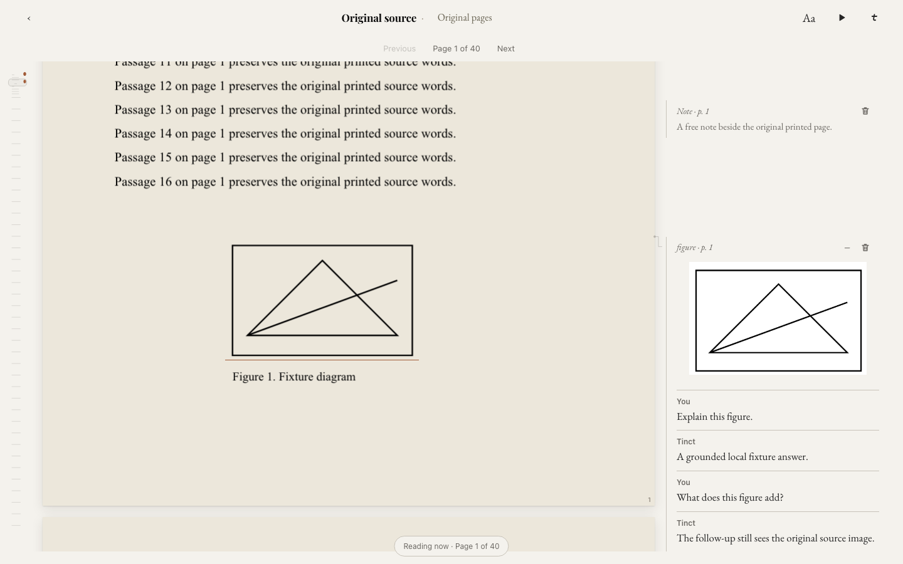

# Reader layout and card repair — 24 October 2026

Restoration candidate for the final pre-Codex reader contract at `d8b667e659009b590bb5e5c9218081c935f74927`, with the user's later straight-rule desktop styling and ebook layout defaults. Local work outside iCloud and production release are explicitly authorized. The source audit is [here](reader-pre-codex-parity-2026-10-24.md). Release acceptance is still in progress; this document does not claim production has changed.

## Reader behavior

- Desktop ebooks default to Two-page; PDFs retain Original pages with a margin. Explicit per-book choices and phone layouts remain respected. Appearance includes three visual layout previews and short descriptions.
- Margin cards share the document scroller, source ordering and collision layout. They grow naturally, minimise into retained rows, reopen from marked passages, and restore after reload. Straight rules, quiet bare controls and source leaders replace rounded desktop popup chrome. Two-page and Compare use bounded floating companions without source reflow.
- Original PDF heading actions are attached to actual text-layer headings, available by pointer/focus/touch with unit-qualified actions. Ebook chapter start/end actions remain visible. Unit cards use semantic chapter boundaries or an explicit free activation position, never the arbitrary edge of a virtual window.
- Passage, free-margin and chapter notes autosave and preserve identity. Persisted note reopening initializes the saved text before autosave. Conversion to Ask preserves note context; clearing a note does not delete an existing colored highlight. Delete supports Undo.
- Each typed request captures its conversation identity before asynchronous work. New cards exclude unrelated chat context; delayed replies, explicit continuation, saved history and hydration keep the same card ownership. Transient drafts and Undo state clear on book/account changes.
- The ebook minimap covers the whole book with exact current-source navigation and saved dots. PDF maps retain original pages and real text geometry. Selection follows source scrolling, expands whole words and preserves real page fragments while excluding page furniture. Cross-page drag keeps native selection pages mounted.
- Original PDF figures reuse the established raster/text detector. View and Copy use a local source crop; typed image questions and follow-ups carry the actual image. Saved cards redraw thumbnails locally rather than storing image blobs in the journal. Voice retains the selected reference and page context separately without pretending it can see an image.
- Quiz replies support up to three graded follow-ups. Desktop Escape first releases typing focus while preserving the draft, then folds the card. Phone card styling remains unchanged.
- Narration uses a compact desktop strip and acquires playback audio-session ownership before assigning an autoplay source or calling play. Pause/stop/unmount release that ownership; Talk priority remains intact.

## Verification

The broad unit sweep passed **7,324 tests** across 597 passing files, with six skipped tests and one skipped file. Later focused regressions cover figure-card rendering, image-only figure follow-ups, keyboard focus and crop reuse. Final ON build `index-D2cdKeLS.js` and bundle verification passed. Source parity, Appearance, persisted notes and figure-image browser acceptance passed against an immutable copy of that build. The broader PDF matrix and final release gate are recorded below as they complete. Final visual regressions verify that leader height changes stay outside the reading column, SVG paths have no fill over source ink, and desktop discussion turns use transparent straight rules.

Completed local acceptance includes 22 source-position scenarios, Chromium and WebKit phone parity, muted narration Play/Pause/word-follow/browsing, Appearance across three themes, and 18 desktop response combinations (three themes, two widths, three layouts). Restored source behavior additionally checks persisted notes through reload/autosave, separate delayed Ask conversations, source-dot navigation, long answers and actual PDF figure image requests. All provider calls are mocked; no private reader documents are used.

Independent review found and corrected saved-note initialization, chapter-boundary placement, cross-book drafts and image-only follow-ups. Rendered browser testing separately exposed a persisted-figure render crash; a reproducing regression failed before the fix and passed afterward. Repository-wide TypeScript has existing unrelated errors and is not reported as a clean gate.

## Gloss comparison

[Gloss](https://www.usegloss.io) was exercised in a separate browser with repository-generated synthetic PDFs: an eight-page two-column academic paper, two-page lecture notes, four-page report and a two-page image-only fixture. No private documents or provider keys were supplied. Its 20-page free PDF limit rejected the separate 21-page prose fixture. Its image-only import displayed explanatory OCR text for the abstract image pattern, while Tinct retains the original image pages.

Observed Gloss import-to-visible-reader times were 544ms for the notes, 572ms for the report and 661ms for the repeated academic-paper import. These are single browser UI measurements, including automation overhead, with its application already loaded. They are not Core Web Vitals or model-response times.

Tinct's built-app timing harness uses the same three text PDFs, fresh isolated Chromium contexts, a local static server, preseeded owner-bound file bytes, and a rendered canvas plus text layer followed by an animation frame as readiness. Three runs per document measure cold navigation, warmed navigation, selection-to-toolbar and click-to-card-shell separately. Raw records and final medians are stored alongside this document. These timings use the final restoration build `index-D2cdKeLS.js`.

| PDF | Cold first readable | Warm first readable | Selection toolbar | Card shell |
| --- | ---: | ---: | ---: | ---: |
| Academic PDF (8 pages) | 233ms | 146ms | 37ms | 32ms |
| Lecture notes (2 pages) | 220ms | 144ms | 35ms | 32ms |
| Report (4 pages) | 212ms | 144ms | 34ms | 31ms |

These checks establish responsive local rendering and a concrete design comparison. They do **not** establish that production Tinct is universally faster than hosted Gloss: import and navigation paths, browser engines, network conditions and cache states differ. A deployed same-workflow comparison remains necessary for that claim. AI answer generation is excluded from the timing comparison.

## Remaining acceptance limits and release gate

Historical figure scope: direct figure actions, source crops and saved image follow-ups are restored. Automatically resolving an arbitrary “Figure N” mentioned in an ordinary text question across other PDF pages is not restored by this repair.

The iPhone Home Screen PWA Bluetooth headset symptom cannot be proven fixed by desktop or WebKit emulation. The audio change corrects a reproduced session-ordering defect (new regression tests fail against the original code), but reconnecting a real headset while book narration runs remains an explicit hardware check.

Production release is guarded by `app/release/shared-reader-rollout.json` (`repair-pending`) and `app/scripts/release-tools.cjs`. The guard requires an explicitly approved repair dispatch for the exact reviewed merge SHA and the pinned accepted reader predecessor. This repair does not weaken or bypass those guards. Production verification remains pending until that guarded release runs.

## Screenshots

These are rendered implementation screenshots, not generated mockups. Response text is synthetic for reproducible UI testing.

