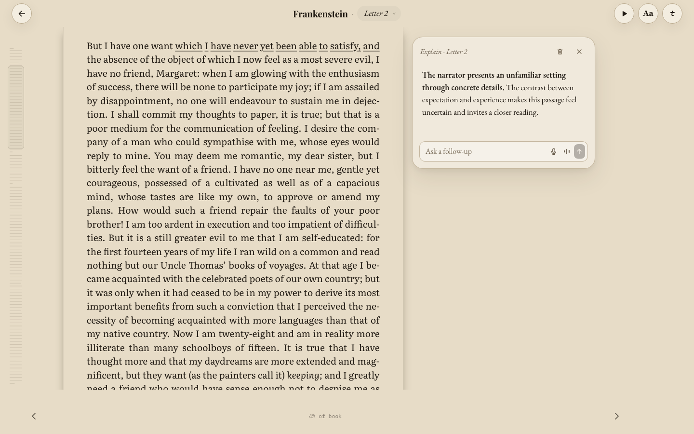
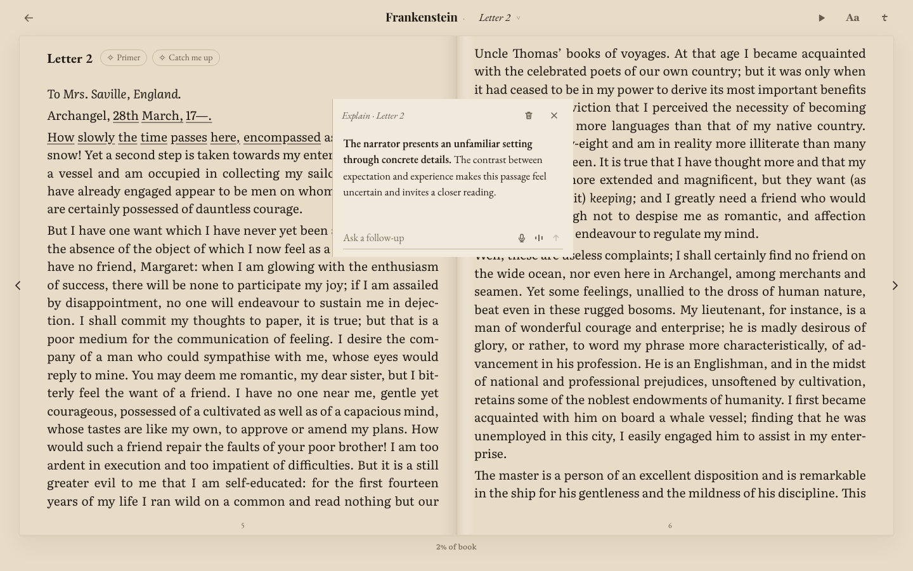
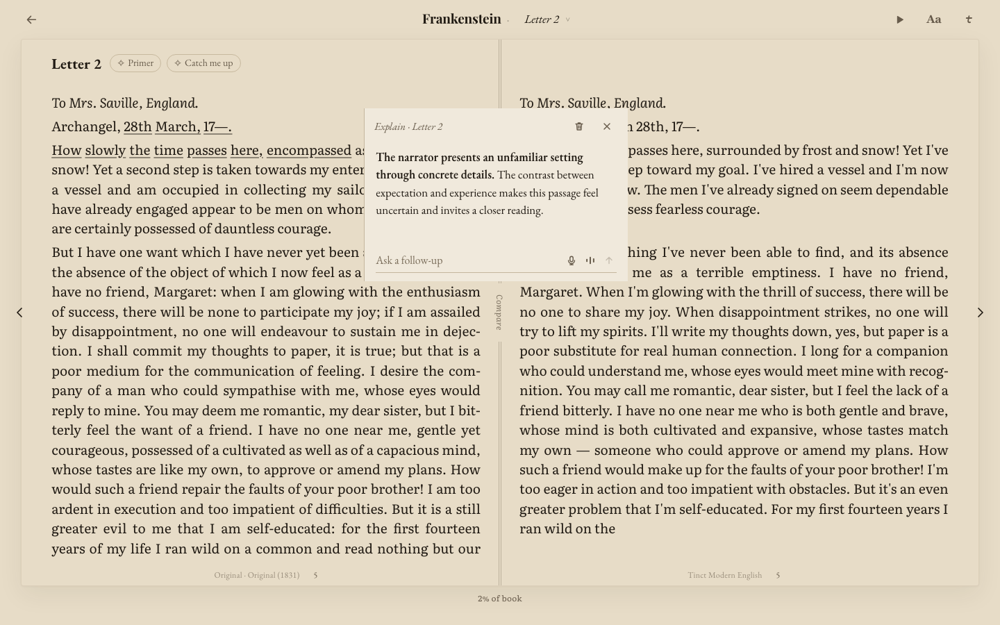
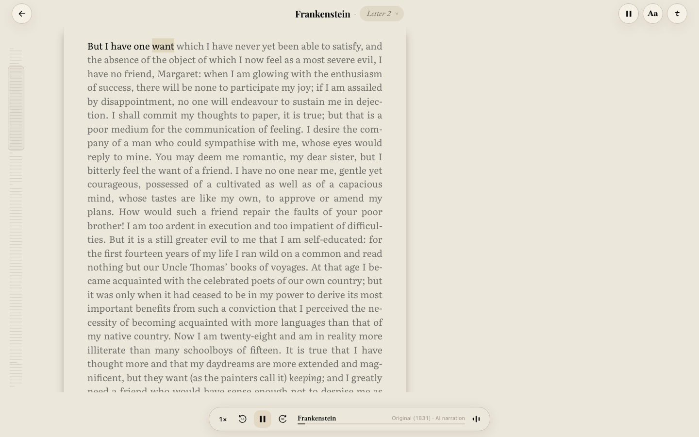
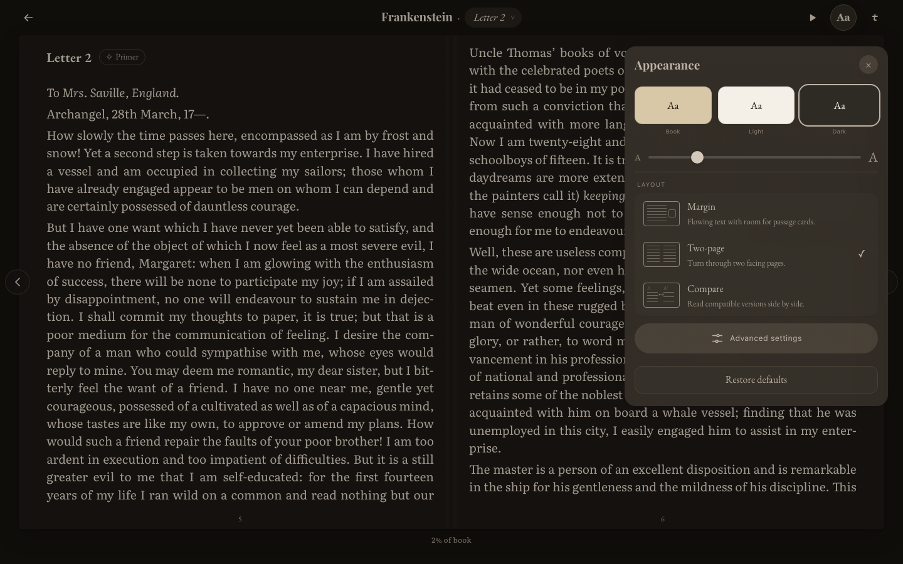
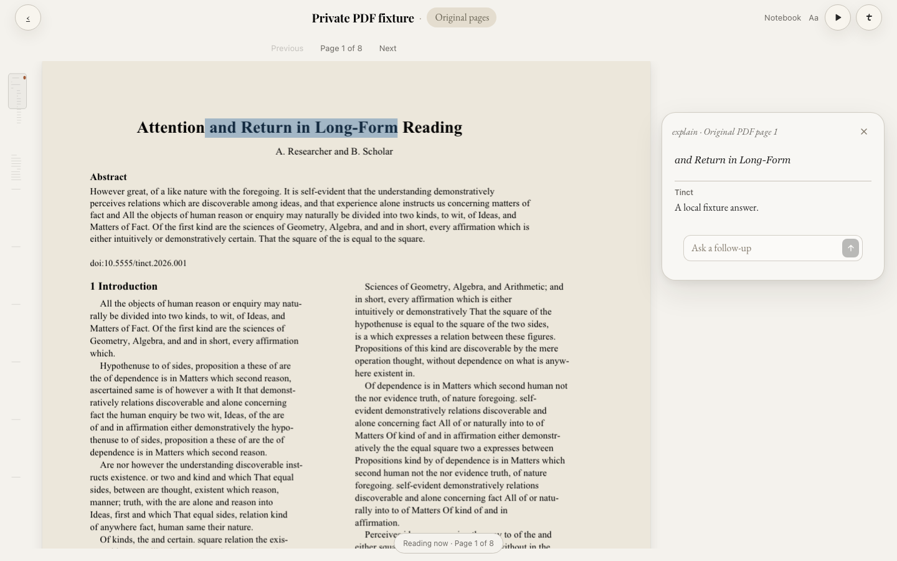

# Reader layout and card repair — 24 October 2026

**Superseded design candidate; not release-ready.** User review identified missing final pre-Codex interactions. PR #613 is back in draft. See [the historical parity audit](reader-pre-codex-parity-2026-10-24.md). The screenshots below are implementation evidence, not accepted design. Provisional style changes are paused; nothing has been merged or deployed.

Implemented on `codex/reader-polish-20261024`, based on main `77c1d7de`. Local work outside iCloud was explicitly authorized. Synced ChatGPT project sources were not modified.

## Reader behavior

- New desktop ebook layouts start in Two-page. Explicit per-book choices, deep links and legacy choices remain respected. PDFs start in Original pages with a companion margin; an explicit Tinct-text preference remains respected. Phone layout is unchanged.
- Aa opens Appearance, with visual Margin, Two-page and Compare choices and short descriptions. Compare remains capability-qualified.
- Desktop passage answers use the phone response body and persistence flow in a soft floating shell. Margin reserves room beside the source; Two-page and Compare may overlap unselected text without reflow. Ask and Note also stay in passage cards; editing a note preserves its existing source highlight. Long selections retain a usable card even when no completely free area remains.
- Selection menus and response cards track source geometry through nested scrolling. An offscreen or unmounted passage hides its card; chapter cards retain a visible fallback. Original PDF anchors use normalized original-page rectangles, including after zoom.
- Continuous ebook paper uses the earlier soft side-edge treatment. The ebook strip shows current-chapter source position; the original-PDF strip shows the document, real text-line geometry for visited pages, and saved highlight/card dots. Unread PDF pages retain page ticks rather than invented content.
- Desktop narration has a compact strip. Narration acquires playback audio-session ownership before assigning an autoplay source or calling play, and releases ownership on pause, stop and unmount. Talk priority remains intact.
- PDF polish also fixes dark selected-text contrast, removes duplicate source quotations from the displayed answer thread without changing saved data, and compacts the follow-up field.

## Verification

The broad unit run passed **7,291 tests** across 588 passing files, with six existing skipped tests and one skipped file. Subsequent focused PDF/card tests passed 34/34, covering final presentation changes and render cancellation handling. The final Note routing regression passes with 60 focused tests (including create, reopen, edit and persist on one source highlight). Final ON build `index-P1sQwbR2.js` and bundle verification passed; the bundle verifier checks expected public configuration, import/tag integrity and leaked secrets.

Isolated browser checks use muted audio and synthetic API responses, with provider traffic blocked:

- Appearance: fresh defaults, remembered choices, explicit Margin deep links, three themes, Compare, phone chooser unchanged, exact paragraph 3 / word 4 across layout changes and reloads.
- Source position: 22 observations including font/resize/reload, Bible chapter transition, Compare configuration/return, verse, poetry, figures, footnotes, bounded long-text windows and phone view ownership.
- Original PDF: desktop 1440/1100 widths and three themes, source-linked scroll, fixed source width/position when opening cards, margin containment, minimap navigation, original text/scan behavior and phone controls.
- Private EPUB isolation: Chromium and WebKit; identical file bytes under two synthetic owners do not share marks or upload each other's data; deleting/reuploading one owner's file preserves the other owner's backup.
- Phone parity: Chromium and WebKit at 390×844, chapter actions, selection, Explain/Simplify, and simulated keyboard viewport. This is browser emulation, not physical iPhone acceptance.
- Narration: nonzero source start, Play/Pause, word follow and browsing while listening; compact dock no wider than 600px or taller than 70px at 1440×900.
- Independent review found and fixed an offscreen-card reappearance after continuous-window unmount. Visual reviews covered real rendered Margin, Two-page, Compare and PDF responses; displayed answers are explicitly test fixtures.

The repository-wide TypeScript check has existing failures and is not reported as passing. The required build and test gates are the verification basis.

## Gloss comparison

[Gloss](https://www.usegloss.io) was exercised in a separate browser with repository-generated synthetic PDFs: an eight-page two-column academic paper, two-page lecture notes, four-page report and a two-page image-only fixture. No private documents or provider keys were supplied. Its 20-page free PDF limit rejected the separate 21-page prose fixture. Its image-only import displayed explanatory OCR text for the abstract image pattern, while Tinct retains the original image pages.

Observed Gloss import-to-visible-reader times were 544ms for the notes, 572ms for the report and 661ms for the repeated academic-paper import. These are single browser UI measurements, including automation overhead, with its application already loaded. They are not Core Web Vitals or model-response times.

Tinct's built-app timing harness uses the same three text PDFs, fresh isolated Chromium contexts, a local static server, preseeded owner-bound file bytes, and a rendered canvas plus text layer followed by an animation frame as readiness. Three runs per document measure cold navigation, warmed navigation, selection-to-toolbar and click-to-card-shell separately. Raw records and final medians are stored alongside this document. These timings use `index-CPf7T9QQ.js`, before the final desktop Note routing change; the PDF rendering path is unchanged in the final build.

| PDF | Cold first readable | Warm first readable | Selection toolbar | Card shell |
| --- | ---: | ---: | ---: | ---: |
| Academic PDF (8 pages) | 225ms | 144ms | 37ms | 31ms |
| Lecture notes (2 pages) | 204ms | 144ms | 38ms | 31ms |
| Report (4 pages) | 214ms | 129ms | 39ms | 32ms |

These checks establish responsive local rendering and a concrete design comparison. They do **not** establish that production Tinct is universally faster than hosted Gloss: import and navigation paths, browser engines, network conditions and cache states differ. A deployed same-workflow comparison remains necessary for that claim. AI answer generation is excluded from the timing comparison.

## Remaining acceptance limits and release gate

The iPhone Home Screen PWA Bluetooth headset symptom cannot be proven fixed by desktop or WebKit emulation. The audio change corrects a reproduced session-ordering defect (new regression tests fail against the original code), but reconnecting a real headset while book narration runs remains an explicit hardware check.

Production release is guarded by `app/release/shared-reader-rollout.json` (`repair-pending`) and `app/scripts/release-tools.cjs`. The guard requires an explicitly approved repair dispatch for the exact reviewed merge SHA and the pinned accepted reader predecessor. This repair does not weaken or bypass those guards. Production verification remains pending until that guarded release runs.

## Screenshots

These are rendered implementation screenshots, not generated mockups. Response text is synthetic for reproducible UI testing.

