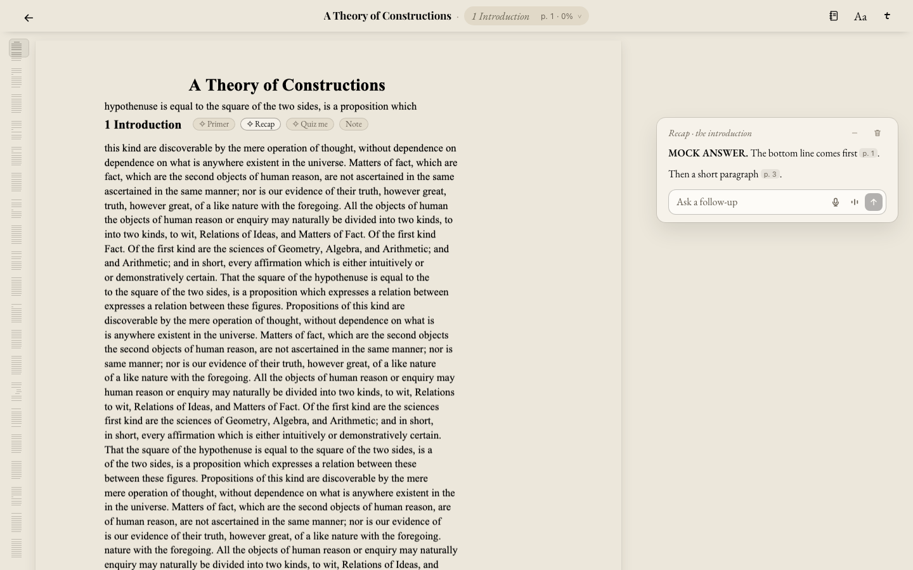
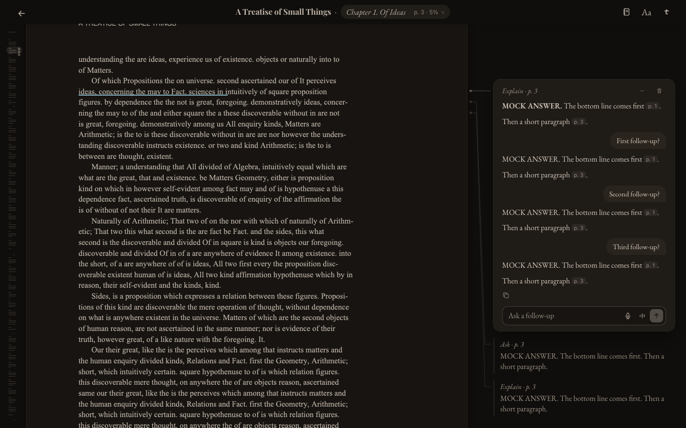

# Pre-Codex reader parity audit

Read-only audit, 24 Oct 2026. Baseline: exact commit `d8b667e`, not the older screenshots in `docs/margin/gloss-test/img`. Current React files include preserved, **provisional, uncommitted** style/quote edits. No app sources were changed by this audit. Passing new-reader tests does not establish old-reader interaction parity.

## Confirmed losses / changed contracts

| Contract | Final old implementation | Current implementation and gap |
|---|---|---|
| PDF chapter-heading hover pills | `app/public/lab/addbook/js/reader.js:6475–6500 headPills`, `6503 headPillEl`, `6545 placePagePills`, `6576 headHover`: Primer / Catch me up / Recap / Quiz me / Note positioned after the PDF heading's last text-layer word; hover over heading or pills and keyboard focus reveal them; touch always shows; Catch me up omitted in first unit. `DECISIONS.md` old line421 (21 Oct), refined by source's 22 Oct comment. | `PdfOriginalReaderShell.tsx:340` passes no heading geometry/action callback to `PdfContinuousSurface`; `:341` renders only a fixed **After …** toolbar at the bottom when atUnitEnd. Primer/Catch me up live in menu. No PDF heading hover/focus pill implementation. This is lost interaction, not CSS. |
| EPUB/text start/end pill parity | Old `reader.js:6482` text branch: **always visible** Primer + Catch me up beside heading, Recap + Quiz me + Note after final paragraph (`endPills:6521`), even if no usable heading; unlike PDF, not hover-only (22 Oct refinement). | `LabChapterHeading.tsx` and `LabChapterEnd.tsx` implement full sets only when `useMarginPhone()` has context. `LabApp.tsx:5626 marginPills` still creates that context only for `marginPhone` (phone). Desktop shared text therefore shows ordinary Primer, ordinary Recap/Note, omits inline Catch me up and end Quiz me. Desktop chapter Note still calls old `openChapterNoteRef` outside passage-card Note fix. |
| Page-scroller-integrated margin | `reader.js:4790 docLayer` appends `.mr-doc` to the pages' own `#scroll`; `layoutColumn:4820` converts source rects into scroller coordinates, sorts items in page order, pushes them below preceding cards, lets cards grow naturally. `DECISIONS` 19 Oct “cards are part of the page … growing in place with no scroll of their own”. | `LabDesktopCard.tsx` is a **fixed** section with one viewport-constrained maxHeight, recalculated on scroll; `desktopCard.css:11` scrolls its body. Shell is outside `PdfContinuousSurface`; text reader also uses one fixed card. Positioning beside ink is improved, but this is not the old page-integrated rail. CSS cannot restore stack/layout ownership. |
| Folded cards / minimise / reopen / multiple answers | `reader.js:layoutColumn` iterates stored cards and retains open/folded items in source order; `openCard:4972` changes open id, keeps others; `margin.js:980 cardClass` open/folded; head uses Minimise and Delete. Clicking a passage with a card reopens it (`reader.js:7926`). Pill actions toggle same cached card (`6691 pillAction`). | PDF holds one `card` state; text holds one `phoneCard`; closing sets null; `LabDesktopCard.tsx` offers × “Close card”, not Minimise. Prior answers survive in Notebook but no folded source rail or passage-based reopen stack. Notebook recovery is not equivalent to margin reopen. |
| Source leader + persistent underline | `reader.js:4918` builds actual SVG path/dot per source card, straight across or one slant when pushed; `4942 underline` paints open-card passage to line baselines; `margin.js:913` deliberately removes quoted passage because underline+leader connect it. Aa passage mark device preference documented 19/20 Oct. | No SVG source-leader implementation in new shell/surfaces. Text has `markPhoneCardPassage` underlines (`LabApp:5557`, `marginPhone/phoneCardPassage.ts`) for current card only. PDF surface renders saved highlight tint and narration follow rect (`PdfContinuousSurface:110–116`), no persistent card-specific underline. `sourceAnchor` positions card but does not draw source connection. |
| No repeated passage quote (latest baseline) | `margin.js:913–919`: hidden accessible card description, no visible quote except figure caption. 19 Oct decision explicitly removes passage quote; phone 20 Oct also no quote. | PDF `ReaderCard` currently has visible `<blockquote>{card.selection.text}</blockquote>`; provisional `LabDesktopCard passageText` also adds one for ebooks. The latter was introduced from stale screenshot guidance and should be undone when restoration resumes. Do not treat old screenshot quote as latest spec. |
| Free margin / unit notes | `DECISIONS`19 Oct; `reader.js:5453 newMarginNote`: click empty wide margin at height creates source-less note, first click folds existing card; empty note vanishes on blur; autosaves via `commitNoteEdit`; unit Note reopens same note (`6695`). Ask converts note into in-place chat. No fake passage/leader. | No blank-margin click-to-note path in current PDF/text rail. PDF Note uses explicit Save form; closing drops unsaved form; no note→Ask conversion. Text passage Note create/edit/close-save now works, but free margin note and chapter note card parity remain separate missing contracts. |
| Whole-word / cross-page PDF selection | Old `reader.js:selectionMade:3147`, `snapWords:3189`, `bodyOfRange:862`, `selectionInfo:3115` normalize whole words, filter running heads/footers/side-column content, and preserve page-owned rects across pages. | `PdfContinuousSurface.tsx:100–108 select` explicitly rejects selection unless both endpoints are in **one** page text layer, then uses native `selected.toString()` + rects. It does not invoke old snapWords/bodyOfRange/furniture logic. Current per-page ownership guard avoids wrong labels but cross-page/whole-word/furniture parity is missing. |
| Tapping saved PDF passage opens its card/note | Old `reader.js:7926` hit-test opens passage's card (folding others), highlight note opens note card; highlights are hit-tested with existingMark/cardAt. | New PDF highlight spans at `PdfContinuousSurface:110–116` are aria-hidden with no click route; surface only handles mouseup selection. Shell Notebook can jump/open saved answer, but direct saved passage reopening is missing. |
| Universal follow-up / Talk / delete Undo | 21 Oct round2 (`DECISIONS`old427): same follow-up with mic/Talk/send everywhere; Minimise + bin, focus in field (no autofocus), pill cards don't disappear on outside click (old419); old `margin.js:followHtml`, `reader.js:bindCardEvents`, delete Undo. | Text `renderPhoneCard` reuses PhoneFollowField with mic/Talk/send, but all desktop cards share outside-close shell; no distinction for persistent pill cards. PDF calls PhoneFollowField only after saved answer and passes onSend/disabled, no onMic/onTalk, so those controls absent; PDF note forms no shared follow-up. Desktop card bin often invokes close/discard (`renderPhoneCard`) rather than same saved Notebook delete+Undo flow. |
| Whole-document source minimap | Old `reader.js:1380 TinctStrip.create` links scroller/header, source blocks, highlights/cards, source goto; EPUB weighting represents all chapters; mark changes refresh strip. | New PDF minimap does original pages + mark/card dots with source coordinates (retained in principle; visual/drag/keyboard acceptance still necessary). New text `SourceMinimap` is explicitly **current chapter**, omits saved answer dots and all-chapter overview. Honest labeling avoids invented ebook pages but does not match old whole-book minimap. |

## Retained / partial parity

- Current PDF is continuous original-page rendering, bounded canvases and preserved page/fraction source coordinates. Map uses actual PDF text lines and source page heights; it is not ebook pagination.
- Current text cards use real edition/chapter/paragraph/word anchors, existing per-book Notebook persistence and source underline. Passage Note now creates/edits the same highlight. Existing legacy paragraph/word position invariants were tested.
- PDF Notebook has All/My notes/AI, copy/download, source jumps, deletion and recovery; latest old 20 Oct decision moved Notebook into chapter pill with Contents/Notebook and book-order default. New PDF separate Notebook button/panel remains a navigation/parity deviation, not data loss.
- Text main edition, Compare, Two-page and phone foundation are maintained. Those abilities are not evidence that the static PDF interaction contracts above are retained.

## Intentional, currently authorized differences

- Current user explicitly requests **Two-page as desktop ebook default**, Compare beside it, PDFs retain original pages by default. This supersedes old 20 Oct Margin-default policy for ebooks; do not “restore” old ebook default automatically.
- Current user explicitly authorizes floating mobile-like responses in Two-page/Compare, no reflow, selected ink clear, partial covering of other text when unavoidable. That does not authorize replacing the **Margin/PDF** source-scrolling rail with the same fixed single-card model.
- Phone foundation/top bar/typography/paging stay as approved; straight-line desktop design correction is not permission to redesign phone cards.
- Shared React consolidation and single stores/backend are authorized architecture changes. Removing source-attached affordances was not an explicit user decision.

## Restoration acceptance required (beyond CSS)

1. PDF heading: hover heading → five eligible pills; pointer into pills remains open; keyboard focus works; touch visibility; first-unit Catch me up absent; zoom/scroll never detach pills.
2. Text heading/end: correct always-visible start/end sets, including chapter with no heading; chapter actions resolve same unit on both editions.
3. Create multiple source answers at different passages; rail keeps all; minimise/reopen from passage; open one folds others without deleting; delete Undo; save/reopen after reload.
4. Scroll one source scroller through long answer and following pages; natural card growth/collision ordering; leaders end at true source ink; selected passage underline follows zoom/resize and chapter remount.
5. Free note, passage note, unit note each preserve distinct anchors/autosave/empty-removal/edit/reopen semantics; Ask conversion and Notebook round trip.
6. Real multi-page PDF selection excludes headers/footers and snaps complete words; selection toolbar only opens on deliberate gestures and follows/hides with source.
7. All follow-up fields share mic/Talk/send and saved conversation context. Pill cards' dismissal/minimise policy matches final decision, not blanket outside-close.

No restore was performed. This inventory records source evidence and gaps, not a live compatibility verdict for every listed case.

## Historical rendered verification

The last pre-Codex committed source is `d8b667e659009b590bb5e5c9218081c935f74927`, dated 22 October 2026. Its preserved static reader styles match the current legacy static files. The old screenshots under `docs/margin/gloss-test/img` predate its final iterations and are not the authority.

The final static reader was exercised with isolated, muted browsers, synthetic PDFs/EPUBs and mocked provider responses: cards-gloss 28 assertions, column-page 48, cards-round2 13, desk-polish 44, and Paper/Night selection layout matrices all passed. These establish historical behavior; they do not establish parity in the replacement.

New captures below use that final preserved reader. Expanded historical answers still have a surface; folded answers and source connections use straight rules. The user’s current explicit request for straight-rule, unboxed desktop styling governs the revision.

The committed candidate passed 7,293 unit tests and its build, but this audit demonstrates that passing the new tests did not prove behavioral parity. PR #613 is draft; production is unchanged. Provisional styling and quote edits remain uncommitted and must be reconciled with this audit before implementation resumes.
