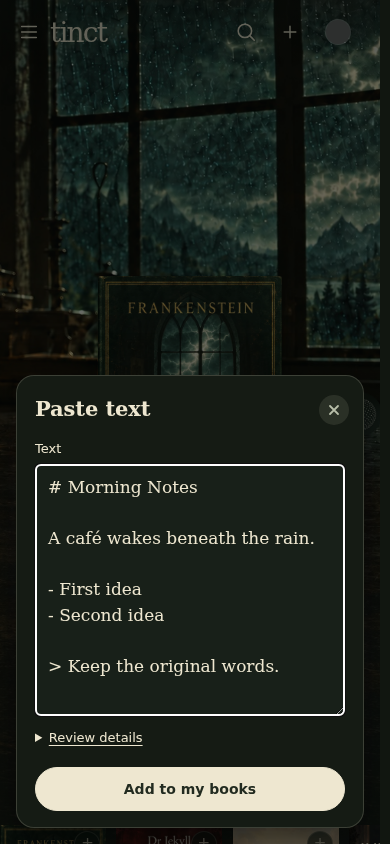
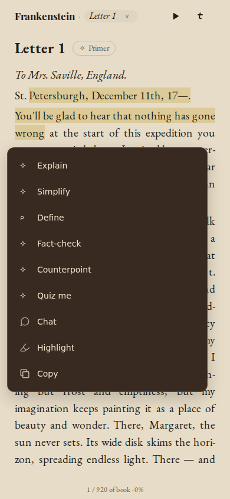
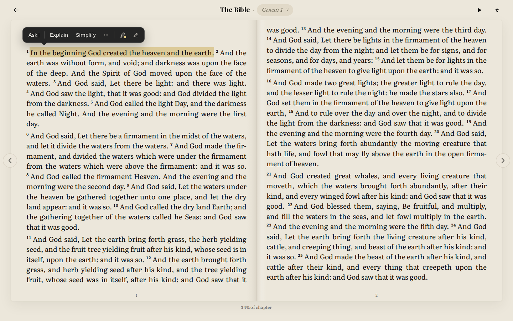
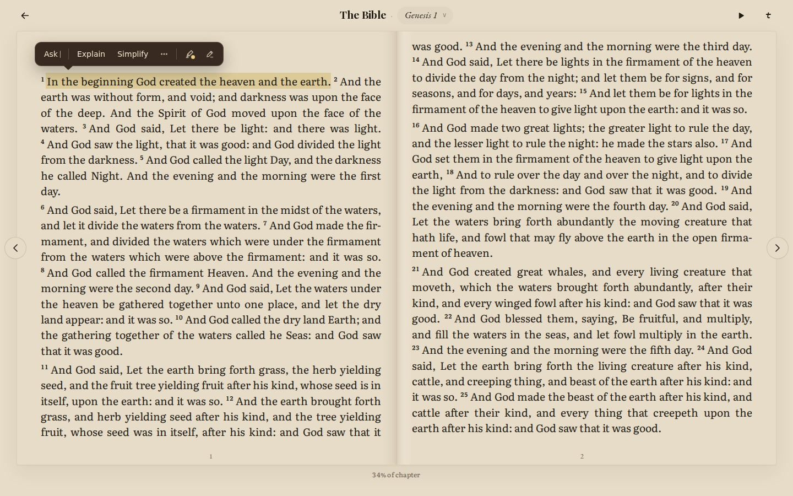
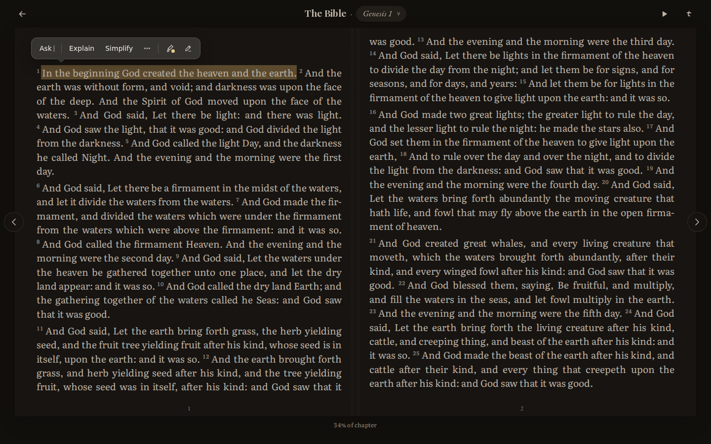
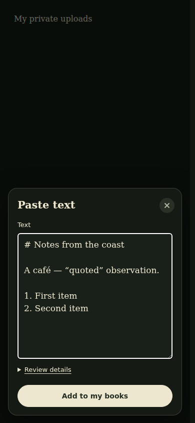
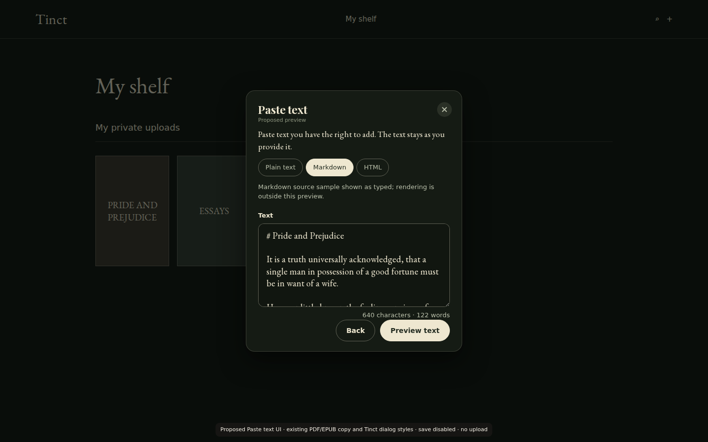
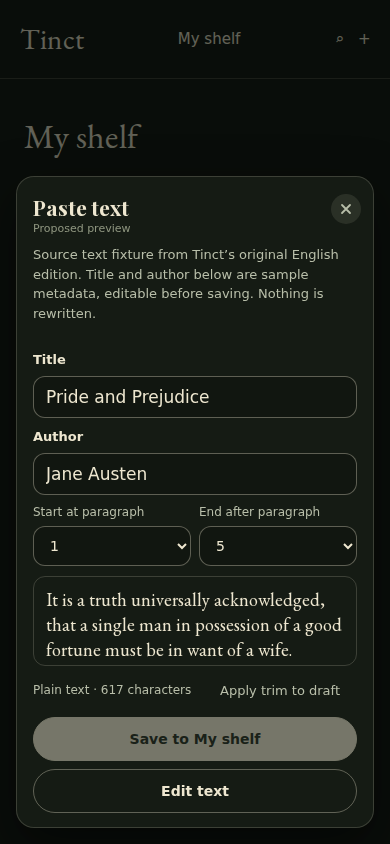

# Shared reader previews, 23 October 2026

These are design candidates, not a shipped release. The actual reader screenshots
use synthetic local state with API/provider/external requests blocked. No user
account data or paid calls were used.

## Final built candidate16

These captures use the actual implementation from source
`a2d3d1a8fa5e81d8539483c232276a515a9f67a0`, frozen ON bundle
`index-Co9oahaE.js`. The browser loads loopback assets with synthetic account
responses and blocked external/provider requests. No styles are injected into
these final captures. They are a release candidate, not a deployed release.

- Desktop 1440×900 reader menu: [Light](assets/shared-reader-2026-10-23/candidate16-desktop-light-reader-menu-1440x900.png), [Book](assets/shared-reader-2026-10-23/candidate16-desktop-book-reader-menu-1440x900.png), [Dark](assets/shared-reader-2026-10-23/candidate16-desktop-dark-reader-menu-1440x900.png).
- Desktop contextual selection: [Light](assets/shared-reader-2026-10-23/candidate16-desktop-light-selection-1440x900.png), [Book](assets/shared-reader-2026-10-23/candidate16-desktop-book-selection-1440x900.png), [Dark](assets/shared-reader-2026-10-23/candidate16-desktop-dark-selection-1440x900.png).
- Paste: [Chromium desktop](assets/shared-reader-2026-10-23/paste-chromium-desktop-1440x900.png), [WebKit phone](assets/shared-reader-2026-10-23/paste-webkit-phone-390x844.png). The actual save/retry/reopen and metadata/source-byte checks pass in both engines on desktop and phone.
- Original PDF: [Primer](assets/shared-reader-2026-10-23/pdf-original-primer.png), [Define](assets/shared-reader-2026-10-23/pdf-original-define.png), [Notebook](assets/shared-reader-2026-10-23/pdf-original-notebook.png). These use real pdf.js rendering of a synthetic PDF and structured mocked responses. The old adjacent You label/empty 0 are absent. Normal, success and dense/incomplete-source journeys pass Chromium and WebKit; real-provider acceptance remains separate.

The menu capture also checks computed theme colours, desktop Ask/Escape/submit,
More keyboard controls, Quiz containment and four phone looks. Capture sources:
`app/scripts/capture-shared-reader-build8.mjs`,
`app/scripts/check-shared-reader-paste.mjs`, and
`app/scripts/check-shared-reader-pdf-original.mjs`.
See the [execution record](shared-reader-release-progress-2026-10-23.md) for
exact-source unit, browser, rollback, performance and release status.

## Earlier design studies

The sections below are retained decision history. Their injected-colour and
illustrative-harness qualifications do not describe the final captures above.

## Selection popup

The desktop screenshots are the actual React reader at 1440x900. Only provisional
popup and selection colours were injected into the isolated browser. Existing copy,
controls, book text, typography, and page layout remain the real UI.

| Theme | Popup surface | Text | Border |
| --- | --- | --- | --- |
| Light | `#252525` | `#f4f2ed` | Quiet 1px border |
| Book | `#382a20` | `#f2e5ce` | Quiet 1px border |
| Dark | `#363431` | `#f3eee5` | Quiet 1px border |

The colours were checked against computed styles, including the Dark selector's
stronger cascade. They are provisional until the visual direction is reviewed.

### Light

### Book

### Dark

The [phone Book screenshot](assets/shared-reader-2026-10-23/selection-phone-book.png)
uses the actual existing compact SelectionPopup at 390x844. The standalone
harness also previews the existing LabPhoneBar; these are different current
surfaces, not evidence that consolidation is complete.

## Paste text

### Revised after Anders's feedback

The multi-step concept below is superseded. The working private Add flow now
starts with one text box and **Add to my books**. Format detection and a
conservative title suggestion happen automatically. **Review details** is
optional; title and author can also be edited later from the book's menu.
Metadata edits keep the source bytes and reading anchors unchanged.

These screenshots show the actual dialog and styles with a synthetic shelf
background. Save/reopen and multi-device acceptance are tracked separately;
the pictures alone do not prove those journeys.

[Smaller phone, 360x740](assets/paste-simple-360x740.png)

### Original concept, retained for decision history

This is proposed UI using the current Tinct dialog styles and existing PDF/EPUB
entry copy. Its library background is illustrative. Plain text, Markdown, and
HTML sample states, editable title/author, paragraph start/end trimming, and a
source preview are shown. Sample metadata is explicitly labelled. Nothing is
uploaded or saved; the save action is disabled.

Formatting controls in this design harness are not an implemented ingestion
parser or security sanitizer. No claim of import fidelity or persistence
acceptance follows from these screenshots.

The [360x740 preview](assets/shared-reader-2026-10-23/paste-preview-small-phone.png)
was also checked: controls fit without horizontal overflow or overlapping captions.

## Running the isolated harness

Run `npm run dev -- --host 127.0.0.1` from `app/`. The repository config currently
serves port 3001. Open:

- `/shared-reader-preview.html?surface=reader&theme=light&device=desktop&clean=1`
- Change `theme` to `book` or `dark`, or `device` to `phone`.
- `/shared-reader-preview.html?surface=paste&step=input&device=desktop&clean=1`
- `/shared-reader-preview.html?surface=paste&step=preview&device=phone&clean=1`

The harness uses real selection controls with illustrative surrounding pages and
is absent from the production Rollup entry list. Do not mistake its standalone
reader fixture for the faithful actual-reader screenshots above. The harness has
no effect on public entry routing, persisted data, or provider services.

See the [execution baseline](shared-reader-cloud-baseline-2026-10-23.md) for test,
build, browser, capability, and remaining acceptance details.
